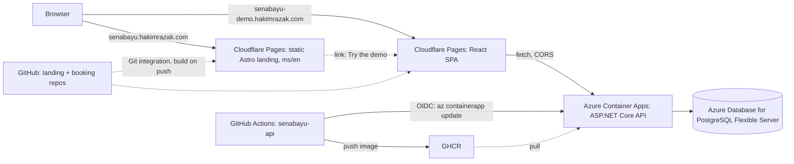
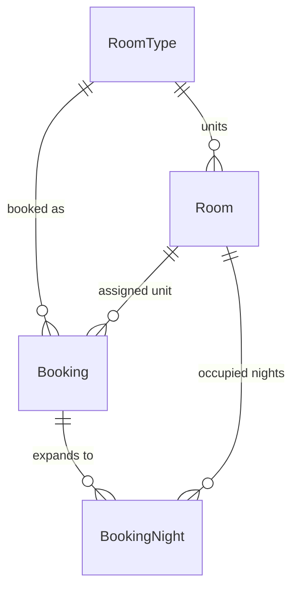

# Homestay Senabayu — Build Plan (MVP-first, three repos)

Malaysian beachside homestay: a **real, live landing page** plus a **deployed booking app** whose job is to be
resume evidence for a **CS internship hunt** — specifically the C#/.NET + React + Docker + Azure keywords MNCs ask for.

> Status: plan only, no application code. This file is the source of truth for all three repos and lives in
> `senabayu-api` (the resume centerpiece).
> Rewritten 2026-10-10 for the internship goal: **one finished, deployed project that matches job ads**, not a
> senior-engineering showcase. The defers are in §9, not deleted.
> Revised 2026-10-21: hosting moved from the VPS to **Azure** for the API (Container Apps + PostgreSQL Flexible
> Server, deployed by GitHub Actions with OIDC).
> Revised 2026-10-21 (b): **the monorepo is split into three independent repos**, each with its own deploy. Both
> frontends go on Cloudflare Pages; only the API is on Azure. The landing no longer fetches from the API. The old
> `Homestay_Senabayu` monorepo is abandoned. See decisions 1, 8, 9, 10, 17, 19, 21, 22.

---

## 1. Goal and what "done" means

You are a final-year CS student applying for internships. Interview reality: resume screen → maybe an online
assessment → behavioral interview + "walk me through your project", occasionally "what's an API / difference
between SQL and NoSQL". Deep architecture questions are rare for interns.

Therefore the win condition is not understanding — it is **shipping**:

| Criterion | Evidence |
|---|---|
| Stack keywords on the resume are true and live | ASP.NET Core Web API + EF Core + Postgres + React + Docker + Azure + GitHub Actions, all reachable at a URL |
| One walkthrough story | "Here's the live link. The hard part: two guests booking the last room simultaneously — I solved it with a DB-enforced invariant and a test that proves one winner." |
| Employability, not depth | 4 weeks to deployed, not 10; the deep work becomes an optional phase 2 you may never need |
| A portfolio that shows it | `kimchi11y.vercel.app` updated (it currently says 2024 / "2nd year" / no C#–.NET–Docker, lists one project, and its LinkedIn link is broken), plus resume bullets |

Non-goal: real reservations. The landing never promises a booked stay; the booking app is labelled a demo.

---

## 2. Locked decisions

| # | Decision | Choice | Status |
|---|---|---|---|
| 1 | Topology | **Three repos, deployed independently:** `senabayu-landing` (Astro), `senabayu-booking` (Vite React SPA), `senabayu-api` (ASP.NET Core + Postgres). No shared code between them; the only contract is the API's OpenAPI document | MVP (revised 2026-10-21 b) |
| 2 | Domain model | `RoomType` → `Room` → `Booking` → `BookingNight` (per-night rows) | MVP |
| 3 | Access | Guest checkout (no guest accounts) + booking-reference lookup; JWT admin | MVP |
| 4 | Backend structure | **Single Web API project, controller-based** (`[ApiController]` + `ControllerBase`, like `BookingSystem`), with folder discipline (`Domain/`, `Data/`, `Controllers/`, `Dtos/`, `Services/`, `Infrastructure/`) — not 4 projects. Controllers stay thin; booking/pricing logic lives in `Services/` so it can be unit-tested | MVP (revised 2026-10-21: controllers over minimal APIs) |
| 5 | Working mode | **Claude writes the code and explains each step**; you read it, run it, and must be able to explain it in an interview (see Resume honesty in §10) | MVP (revised 2026-11-07) |
| 6 | Time budget | ~8–10 h/week, **4 weeks (~41 h)** | MVP (revised) |
| 7 | Sequence | API skeleton live → SPA booking flow → invariant + admin → landing + portfolio | MVP |
| 8 | Hosting | **API on Azure** (Azure for Students subscription, region **Malaysia West**, which the subscription policy allows; Southeast Asia is blocked): image on **Azure Container Apps** (Consumption, scale-to-zero); **Azure Database for PostgreSQL Flexible Server** (smallest burstable SKU). **Landing and SPA on Cloudflare Pages** (free), each via Cloudflare's Git integration | MVP (revised 2026-10-21 b) |
| 9 | Dev loop | Each repo runs on its own. API: one local-only `compose.yml` — `docker compose up -d db` for Postgres while the API runs in Rider (connection string in user-secrets), or the full api + db stack for container verification. SPA: `pnpm dev` with `VITE_API_BASE_URL` pointing at the local or deployed API. Landing: `pnpm dev`, no dependencies | MVP (revised) |
| 10 | Landing data | **Room content hardcoded in the landing repo** (a typed data file / content collection), static output; WhatsApp is the real CTA; "Try the booking demo" links to the SPA. No build-time API fetch | MVP (revised 2026-10-21 b) |
| 11 | Content | Real property; photos/copy later → placeholder imagery now, swap when it arrives | MVP |
| 12 | Locale | `ms` + `en` with a visible switcher on the landing (cheap because content is placeholder); in the API, room text comes from locale columns | MVP |
| 13 | Pricing | Flat nightly rate + min-nights + extra-guest fee, behind one pricing function | MVP |
| 14 | Lifecycle | `Pending → Confirmed/Cancelled`, admin-confirmed; **no email/SMS** | MVP |
| 15 | Double-booking | **DB-enforced**: `BookingNight` rows + partial unique index `(room_id, night_date) WHERE status <> 'Cancelled'`; `23505 → 409`; naive check first, failing test kept | MVP — the flagship story |
| 16 | Media | Placeholder images committed to the landing repo; upload pipeline to Azure Blob Storage | **Phase 2** |
| 17 | Testing + CI/CD | **API:** unit tests (pricing/dates/state machine) + Testcontainers Postgres for booking-create and the N-concurrent race; CI build/test/`docker build`; CD on `main`: push image to GHCR → deploy to Container Apps via GitHub Actions + OIDC. **SPA + landing:** a small CI workflow (typecheck + build) on PRs; deploys handled by Cloudflare Pages on push to `main`, with a preview URL per PR. No e2e, no coverage gates | MVP (revised 2026-10-21 b) |
| 18 | React stack | TanStack Query + OpenAPI-generated client + react-hook-form + Zod + React Router + shadcn/ui + Tailwind | MVP |
| 19 | Repo wiring | **Per repo, nothing shared.** API: one .NET solution + `compose.yml` + `global.json` + `dotnet-tools.json`. SPA and landing: plain pnpm projects. No workspace, no Taskfile — each README lists its handful of commands | MVP (revised 2026-10-21 b) |
| 20 | Demo safety | Seed + manual reset endpoint + per-IP rate limits on public writes | MVP (nightly job → Phase 2) |
| 21 | Domains | `senabayu.hakimrazak.com` (landing → Cloudflare Pages), `senabayu-demo.hakimrazak.com` (SPA → Cloudflare Pages), `api.senabayu-demo.hakimrazak.com` (API → Container Apps). Pages custom domains are added from the Pages dashboard (proxied, certificates automatic). The API hostname is a **DNS-only (grey-cloud) CNAME** to Azure so Azure's free managed certificate validates and renews. Swap to the property's own domain later with 301s | MVP (revised 2026-10-21 b) |
| 22 | Content freshness | Not needed: the landing no longer depends on API data. If phase 2 ever moves room content into the API, add a build-time fetch + a Cloudflare Pages deploy hook then | **Removed** (2026-10-21 b) |
| 23 | Admin scope | Login + bookings list + confirm/cancel + demo reset. Room-type/room CRUD | MVP / **Phase 2** |
| 24 | Portfolio update | Updating the portfolio site, LinkedIn, and resume bullets is a **first-class deliverable** in M4, not an afterthought | MVP |
| 25 | Cloud guardrails | One resource group `rg-senabayu`; **budget alert** on the subscription before anything is created; image in **GHCR (public package)** rather than ACR to save credit; Postgres public access restricted by firewall + TLS required; connection string and JWT key as **Container Apps secrets**, never in the image or repo; resources created by hand with `az` CLI commands recorded in `deploy/azure/README.md` (Bicep is Phase 2) | MVP |

### Decisions I made without asking (reversible, reasoned)

- **Three repos over a monorepo.** Each repo has one stack, one deploy target and one README, so there is no
  workspace tooling and no path-filtered CI. The cost: an API contract change takes two PRs (API, then SPA client
  regeneration). For one developer that is cheap.
- **The plan lives in `senabayu-api`.** It's the repo recruiters open first; its README links to the other two
  repos and all three live URLs.
- **Cloudflare Pages Git integration over GitHub Actions deploys for the frontends.** Connect the repo in the
  dashboard and it builds on push, with per-PR previews and no deploy token in GitHub. The Actions-based CD story
  is told once, properly, in the API repo.
- **SPA on Cloudflare Pages, not Azure Static Web Apps.** Same workflow as the landing; Azure stays on the resume
  through the API, which is where the Docker + Container Apps + Postgres story is.
- **Landing data hardcoded.** The landing is marketing copy. Fetching it from a scale-to-zero API at build time
  couples a free static deploy to a cold-starting container for no visible benefit.
- **Committed OpenAPI snapshot in the SPA repo.** `pnpm gen:api` downloads `/openapi/v1.json` from a running API
  into `openapi/v1.json` and regenerates the typed client from it. Both are committed, so the SPA builds without
  the API running and a contract change shows up as a reviewable diff.
- **Single API project, folder discipline.** Compiler-enforced layering is a senior-interview topic; you need
  the keyword and a working app. Keep `Domain/` free of EF attributes and put all EF mapping in
  `Data/IEntityTypeConfiguration<T>` — then the phase-2 split into `Core` + `Infrastructure` is mechanical.
- **Honest limitation:** inside one project nothing *stops* a wrong dependency. That's the accepted trade;
  §9 stage 1 restores enforcement if you ever want it.
- **Versioning, errors, validation, docs:** `/api/v1`, `ProblemDetails` with a stable `code`, FluentValidation,
  Swagger UI (Swashbuckle — you already know it from `homestay-api`).
- **Admin minimal:** without room CRUD, the demo's rooms come from the seed. Fine for a demo, and it removes
  the largest chunk of UI work.
- **Localized room content:** explicit locale columns (`NameMs`, `NameEn`, `DescriptionMs`, `DescriptionEn`).
- **Subdomain, not path:** `senabayu.hakimrazak.com`, never `hakimrazak.com/senabayu`.
- **Image storage is invisible to SEO:** what Google sees is the served URL, format, size, `alt`, dimensions.
- **Azure over AWS:** the resume pitch is C#/.NET, and Microsoft-stack employers list ".NET + Azure" together;
  Azure for Students gives credit without a credit card. Revisit only if saved job ads say AWS.
- **Container Apps over App Service:** it runs the same Docker image built in M1, so the Docker story and the
  cloud story are one story; health probes reuse `/health/live` and `/health/ready`; scale-to-zero saves credit.
- **Managed Postgres over a Postgres container in the cloud:** the "managed database" keyword and automated
  backups are worth the credit. Fallback if credit runs low: Postgres as a second container app with an Azure
  Files volume (loses the keyword and backups).
- **GHCR over ACR:** free, already next to the code. The image contains no secrets, so a public package is fine.
  ACR + managed-identity pull is a Phase 2 upgrade if you want that keyword.
- **Migrations run as an EF migrations bundle**, never on app startup (scale-out replicas would race). M1: run it
  by hand from your machine with your IP allowed in the Postgres firewall. Automated in CD by M3, when migrations
  start changing.

---

## 3. Architecture (MVP)



Two static sites on Cloudflare Pages, one API container and one managed database on Azure. The only runtime
link between repos is the SPA calling the API; the landing just links to the SPA. Azure terminates TLS (free
managed certificate) for the API hostname; Cloudflare serves DNS for it. Locally, `compose.yml` runs the same API
image against a Postgres container with a named volume.

---

## 4. Repo structures

### `senabayu-api`

```text
senabayu-api/
├── PLAN.md                        # this file — the plan for all three repos
├── README.md                      # portfolio-facing: diagram, screenshots, live links to all three, how to run
├── Homestay.slnx
├── global.json                    # pins the .NET 10 SDK
├── dotnet-tools.json              # dotnet-ef
├── .editorconfig
├── .gitignore
├── Dockerfile                     # multi-stage: SDK -> aspnet runtime, non-root
├── compose.yml                    # local, production-shaped: api, db (+ volume, healthchecks, network)
├── .env.example
├── .github/workflows/
│   ├── ci.yml                     # PRs + main: build, test, docker build
│   └── deploy.yml                 # main: build+push image to GHCR -> OIDC login -> az containerapp update
├── deploy/
│   └── azure/README.md            # every az CLI command used to create the resources, in order (runbook)
├── docs/
│   ├── specs/                     # one spec per milestone/slice
│   └── notes/                     # milestone retros
├── src/Homestay.Api/
│   ├── Domain/                    # entities + rules; NO EF attributes, NO EF usings
│   ├── Data/                      # DbContext, IEntityTypeConfiguration, Migrations, Seed
│   ├── Controllers/               # Bookings | Availability | RoomTypes | Auth | Admin | Demo — thin, HTTP only
│   ├── Dtos/                      # request/response records
│   ├── Services/                  # BookingService, PricingService, ... — the logic the tests target
│   ├── Infrastructure/            # JWT, clock, password hashing
│   └── Program.cs
└── tests/Homestay.Tests/          # unit + Testcontainers integration
```

### `senabayu-booking`

```text
senabayu-booking/
├── README.md                      # what it is, live link, link to senabayu-api, how to run
├── package.json                   # scripts: dev | build | typecheck | lint | gen:api
├── .env.example                   # VITE_API_BASE_URL
├── .github/workflows/ci.yml       # PRs: typecheck + build (deploys are Cloudflare's job)
├── openapi/v1.json                # committed snapshot of the API contract
├── index.html
├── vite.config.ts
└── src/
    ├── app/                       # router, providers, layout, error boundary
    ├── features/                  # rooms | booking | lookup | demo | admin
    ├── components/ui/             # shadcn/ui
    └── lib/
        ├── api/                   # generated types/client (from openapi/v1.json) + thin fetch wrapper
        └── ...                    # query keys, zod schemas, helpers
```

SPA deep links: Cloudflare Pages serves `index.html` for unknown paths when the build output has no top-level
`404.html`, so client-side routes survive a refresh with no extra config. Verify it in M2 rather than assume.

### `senabayu-landing`

```text
senabayu-landing/
├── README.md
├── package.json
├── .github/workflows/ci.yml       # PRs: astro check + build
├── astro.config.mjs               # site URL, i18n (ms default, en), sitemap integration
├── public/                        # placeholder photos, favicon, robots.txt
└── src/
    ├── pages/                     # / (ms), /en/
    ├── layouts/
    ├── components/
    ├── data/rooms.ts              # hardcoded room types: names/descriptions per locale, indicative MYR rates
    ├── i18n/                      # UI strings ms/en
    └── styles/
```

---

## 5. Data model and invariants



- **RoomType** — `Id`, `Code` (unique), `NameMs/NameEn`, `DescriptionMs/DescriptionEn`, `BasePricePerNight`
  (MYR), `MaxGuests`, `MinNights`, `ExtraGuestFeePerNight`, `IsActive`.
- **Room** — `Id`, `RoomTypeId`, `Number` (unique), `IsActive`.
- **Booking** — `Id`, `Reference` (unique, `SBY-XXXXXX`), `RoomTypeId`, `RoomId`, `CheckIn`, `CheckOut`
  (check-out exclusive), `GuestName`, `Email`, `Phone`, `GuestCount`, `PricePerNightSnapshot`, `Nights`,
  `ExtraGuestFee`, `TotalAmount`, `Currency` (`MYR`), `Status` (`Pending|Confirmed|Cancelled`), audit fields.
- **BookingNight** — `Id`, `BookingId`, `RoomId`, `NightDate`, `Status` (`Active|Cancelled`). **The invariant table.**
- **AdminUser** — `Id`, `Email` (unique), `PasswordHash`, `Role`.

**Invariants**
1. **No double-booking** — partial unique index on `BookingNight`: `(room_id, night_date) WHERE status <> 'Cancelled'`.
   Concurrent inserts yield `23505` → `409 Conflict`.
2. Dates sane: `CheckOut > CheckIn`, nights ≥ `MinNights`, `CheckIn >= today`.
3. Transitions: `Pending → Confirmed|Cancelled`, `Confirmed → Cancelled`; terminal states reject further changes.
4. `TotalAmount = Nights × PricePerNightSnapshot + Nights × ExtraGuestFee × max(0, GuestCount − 2)`.
5. `GuestCount ≤ MaxGuests`.
6. Availability = rooms of a type with no `BookingNight` in `[CheckIn, CheckOut)` with `Status = 'Active'` —
   the payoff of nightly rows: no interval arithmetic.

The landing's `rooms.ts` and the API seed describe the same rooms but are maintained separately. Keep them
roughly in sync by hand; they don't have to match exactly, because the landing shows indicative prices and the
demo shows demo prices.

---

## 6. API surface (MVP)

**Public:** `GET /api/v1/room-types?locale=`, `GET /api/v1/room-types/{code}`,
`GET /api/v1/availability?checkIn&checkOut&roomTypeId`, `POST /api/v1/quote`, `POST /api/v1/bookings`
(`201` + reference, `409`, `400`, `429`), `GET /api/v1/bookings/{reference}?email=` (lookup),
`GET /health/live`, `GET /health/ready`.

**Admin (JWT bearer):** `POST /api/v1/admin/auth/login`, `GET /api/v1/admin/bookings?status&page`,
`POST /api/v1/admin/bookings/{id}/confirm`, `POST /api/v1/admin/bookings/{id}/cancel`,
`POST /api/v1/admin/demo/reset`, `GET /swagger` (dev/staging), `GET /openapi/v1.json`.

Every error is `ProblemDetails` with a stable `code` string. CORS allows `https://senabayu-demo.hakimrazak.com`
and `http://localhost:5173` only (Cloudflare preview URLs are not allowed; test previews against a local API).

---

## 7. Flagship flow

```mermaid
sequenceDiagram
  participant U as Guest (SPA)
  participant A as API
  participant D as Postgres
  U->>A: POST /quote (dates, type, guests)
  A-->>U: price breakdown
  U->>A: POST /bookings
  A->>D: BEGIN; pick free room; INSERT Booking + BookingNight rows; COMMIT
  alt unique violation (23505)
    A-->>U: 409 Conflict (room taken)
  else success
    A-->>U: 201 + reference
  end
```

Build order: naive overlap check → a test proving it loses under concurrency → nightly rows + index → the same
test passes and stays in the repo as the proof.

---

## 8. MVP milestones (~41 h)

Each milestone is a runnable, deployed increment. Per slice: Claude writes the spec and code and explains them; you run, read and merge.

**M1 — `senabayu-api` skeleton live on Azure (≈12 h).**
Repo + .NET solution; single `Homestay.Api` project; EF Core + Postgres (compose, named volume); first migration +
seed (3 room types, 5 rooms); `GET /api/v1/room-types`; Swagger; multi-stage Dockerfile; compose with api/db
locally; **Azure:** budget alert, resource group, PostgreSQL Flexible Server, Container Apps environment + app,
custom domain + managed cert; CI green; **CD deploys `main` to Container Apps via OIDC**.
*Acceptance:* `https://api.senabayu-demo.hakimrazak.com/swagger` is live and returns the seeded rooms; a merge to
`main` redeploys with no manual step; local data survives `compose down && up`; CI green.
*Concepts to be able to explain:* image vs container, multi-stage builds, why non-root, named volumes,
healthchecks vs Container Apps probes, compose services/networks, EF migrations, DI lifetimes, OIDC federated
credentials vs stored secrets, managed database vs database container, scale-to-zero and cold starts.

**M2 — `senabayu-booking` SPA booking flow (≈10 h).** Vite + React + TS + Tailwind + shadcn + TanStack Query +
generated client (from the committed `openapi/v1.json`); rooms list, availability, quote, booking form (RHF + Zod),
confirmation + reference lookup; repo connected to **Cloudflare Pages** with the custom domain
`senabayu-demo.hakimrazak.com` and `VITE_API_BASE_URL` set as a Pages build variable; API CORS allows that origin.
*Acceptance:* a booking can be created end-to-end from a phone browser at the live URL; the typed client came
from the OpenAPI document; deep links (e.g. `/lookup`) survive a refresh; a PR gets a Cloudflare preview URL.
*Concepts:* SPA + API separation, CORS, build-time env vars in a static bundle (and why secrets can't go there),
query caching/invalidation, client-side validation mirroring the API, static hosting + SPA navigation fallback.

**M3 — The invariant + admin (≈10 h, mostly `senabayu-api`).** `BookingNight` + partial unique index +
`23505 → 409` (after the naive version and its failing test); unit tests for pricing/dates/transitions;
Testcontainers race test; JWT admin login + bookings list + confirm/cancel with transition validation; rate
limiting; demo reset endpoint; **migrations bundle applied automatically in `deploy.yml` before the image rolls
out**; JWT signing key as a Container Apps secret. Admin screens + `409`/`429` handling in `senabayu-booking`
after regenerating the client.
*Acceptance:* the race test proves exactly one winner; illegal transitions return `409`; admin flow works live;
burst POSTs get `429`; a migration merged to `main` reaches Azure Postgres without a manual step.
*Concepts:* DB constraints as invariants, transactions, SQLSTATE handling, JWT auth/authorization, rate limiting
(and why per-IP limiting needs the real client IP behind Azure's ingress — `X-Forwarded-For`).

**M4 — `senabayu-landing` + portfolio (≈9 h).** Astro landing (`ms`/`en` + switcher, placeholder photos), WhatsApp
CTA, room cards from `src/data/rooms.ts`, "Try the booking demo" link, SEO (per-locale meta, canonical,
`hreflang`, sitemap, robots, OG, JSON-LD `LodgingBusiness`), Cloudflare Pages on `senabayu.hakimrazak.com`,
Search Console + sitemap, Lighthouse ≥95; `senabayu-api` README with architecture diagram + screenshots + live
links to all three; **update the portfolio site (`hakims-portfolio`, `lib/data.ts`), LinkedIn, and resume
bullets**; pin all three repos on GitHub.
*Acceptance:* landing live and indexable; Lighthouse ≥95; each README lets a stranger run that repo; portfolio
lists this project with the live links and corrected LinkedIn URL.
*Concepts:* static rendering vs SSR, Core Web Vitals, structured data, technical writing for a portfolio.

The landing has no dependency on the other two, so it can be pulled earlier (e.g. as a weekend break between
milestones) without changing anything else.

---

## 9. Phase 2 backlog (only if time remains — the pressure valve for scope creep)

Ordered by resume value:

1. **Split the API** into `Homestay.Core` (Domain + Application) + `Homestay.Infrastructure` + `Homestay.Api`,
   with a CI test asserting Domain/Application reference no EF — the enforceable version of decision 4.
2. **Infrastructure as Code:** turn `deploy/azure/README.md` into **Bicep** (or Terraform) deployed from Actions —
   the next-best Azure resume line after "deployed on Container Apps".
3. **Media upload pipeline** to Azure Blob Storage (restores decision 16).
4. **Nightly demo reset** as a Container Apps scheduled Job + `Blocked` nights for maintenance blackout dates.
5. **Testcontainers + broader integration suite**, then Playwright e2e on the booking happy path.
6. **Ops hardening:** Application Insights (OpenTelemetry) + Log Analytics queries; restore drill from Flexible
   Server point-in-time backup; Key Vault references instead of Container Apps secrets; ACR with managed-identity
   pull; Postgres on private networking (VNet) instead of public access + firewall.
7. **Second-phase frontend depth:** admin room CRUD, seasonal rate overrides behind the existing pricing seam.
8. **Contract check in SPA CI:** fetch the live `/openapi/v1.json` and fail if it differs from the committed
   snapshot.

---

## 10. Working agreement

- **Claude writes the application code and explains it; you read and run it.** Don't merge what you can't explain.
- **One branch per slice** (`feat/booking-create`), PR into `main`, description = what/why/how verified; I review
  before merge; squash merge; Conventional Commits.
- **Definition of done per slice:** builds; runs locally; new logic has a test; migrations committed; README
  updated if the workflow changed; no `TODO`s; you can explain it out loud. **If the API contract changed:** the
  follow-up `senabayu-booking` PR regenerates `openapi/v1.json` + the client before the slice counts as done.
- **Milestone retro:** 5 lines in `senabayu-api/docs/notes/` — what I built, how it works, what surprised me.
  Becomes README material and is your self-administered exam.
- **Change control:** anything that contradicts this file gets added to §2 or §9. New ideas go to the backlog,
  not into the current milestone.
- **Resume honesty:** don't list what you can't discuss. Two things you *must* understand because they're one
  question away: Docker basics (image/container/volume, multi-stage) and EF Core basics (DbContext, migrations).

---

## 11. Verification

| Artifact | Proof |
|---|---|
| API | Live Swagger on Azure Container Apps; `curl` transcripts in PRs; unit + Testcontainers integration tests green |
| Concurrency | A test that fails without the unique index, passes with it; burst test asserting one winner |
| SPA | Live booking created from a phone on Cloudflare Pages; generated client committed and in sync with the API |
| Docker | Fresh clone of `senabayu-api` → `compose up` reproduces the stack locally; Postgres data survives container recreation |
| Azure / CD | Merge to `main` → green `deploy.yml` run → new revision live; no Azure credential stored in GitHub; `deploy/azure/README.md` recreates the resources |
| Landing | Lighthouse ≥95 (mobile), Rich Results pass, Search Console coverage, live URL on a real phone |
| Portfolio | Updated site/LinkedIn/resume with the live links; every claim traceable to code you wrote |

---

## 12. Risks and open items

**Risks**
- *Placeholder content on a live page* (accepted): swap when real photos/copy land; re-request indexing then.
- *Scope creep* (the main one): §9 is where good ideas go. The 4-week window is the point of this plan.
- *Overclaiming on the resume* (avoidable): only list what you can demo and explain.
- *Contract drift between API and SPA* (low): the committed OpenAPI snapshot makes it visible; the definition of
  done requires the regeneration PR; §9 item 8 automates the check.
- *Temporary domain* (accepted): `senabayu.hakimrazak.com` accumulates SEO equity; 301 to the property's own
  domain later with a Search Console address change.
- *Azure credit burn* (medium): managed Postgres is the main ongoing cost (roughly US$12–15/mo at the smallest
  burstable SKU unless covered by a free-services allowance — check your offer). Mitigations: budget alert first,
  stop the Postgres server between demo periods, fallback to a Postgres container app. Never let the demo depend
  on a card-backed subscription you can't monitor.
- *Credit expiry* (accepted): Azure for Students renews yearly while you're a student; after graduation, either
  pay a few dollars a month, move to the fallback, or keep the screenshots + recorded demo in the README.
- *Cold starts* (accepted): scale-to-zero means a few seconds on the first request after idle, so the SPA shows a
  loading state rather than an error. Set min replicas to 1 only around interviews if needed. The landing is
  unaffected.

**Open items — facts, not decisions**
| Needed by | Item |
|---|---|
| M1 | ~~Product name~~ **resolved:** "Homestay Senabayu". ~~Git host~~ **resolved:** GitHub `kimchi11y` |
| M1 | Create the three GitHub repos: `senabayu-api`, `senabayu-booking`, `senabayu-landing` |
| M1 | Azure for Students subscription activated (university email); confirm which regions its policy allows and whether PostgreSQL Flexible Server B1ms is in the free-services allowance |
| M1 | Cloudflare DNS access for `hakimrazak.com` to add the `api.senabayu-demo` CNAME + `asuid` TXT verification record |
| M2 | Cloudflare Pages project for `senabayu-booking` connected to GitHub |
| M4 | WhatsApp number + default enquiry message |
| M4 | Property location (town/state) for copy, map embed, local keywords |
| M4 | Rough inventory (room types, room counts, indicative MYR rates) — seed values otherwise |
| Later | Real photos + `ms`/`en` copy, Google Business Profile access |

---

## 13. Next action

**Step 0 (today, 10 minutes, unrelated to this build):** fix the production placeholders on `hakimrazak.com` —
`lib/data.ts` still ships the template's `hakim.doe@example.com` and the social links point at
`github.com/johndoe` / `linkedin.com/in/johndoe`. Anything a recruiter clicks today goes to a stranger's profile.

**Step 1:** create `senabayu-api`, put this file in it, and start **M1**. The old M1 spec
(`Homestay_Senabayu/docs/specs/m1-skeleton-api-live.md`) is monorepo-shaped; rewrite it for the single-repo API
before coding. First tasks: repo, solution, single API project, EF + migration + seed, `GET /room-types`.
In parallel (it can take a day): activate Azure for Students and set the budget alert.
