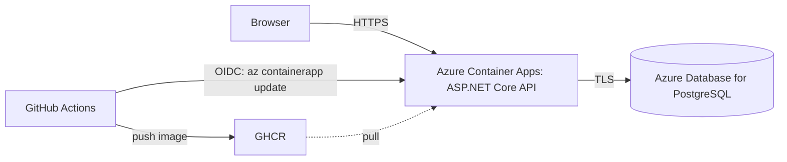

# Senabayu API

Booking API for Homestay Senabayu, a Malaysian beachside homestay. This is a demo: it doesn't take real reservations.

**Live:** [Swagger UI](https://api.senabayu-demo.hakimrazak.com/swagger) ·
[room types](https://api.senabayu-demo.hakimrazak.com/api/v1/room-types?locale=ms)

**Stack:** ASP.NET Core Web API (.NET 10), EF Core, PostgreSQL, Docker, Azure Container Apps, GitHub Actions

## Architecture



The first request after the API has been idle can take a few seconds, because it scales to zero.

## Run locally

Requires Docker and, for development outside a container, the .NET 10 SDK.

```bash
cp .env.example .env
docker compose up --build
```

Compose starts Postgres, applies migrations and seed data, then starts the API at
<http://localhost:8080/swagger>.

To run the API from your IDE instead, see [the local development guide](docs/guides/local-dev.md).

## Test

```bash
dotnet test
```

## Deployment

Each push to `main` runs the tests, builds an image tagged with the commit SHA, pushes it to GHCR, rolls it out to
Container Apps, and smoke-tests `/health/ready`. GitHub logs in to Azure with OIDC, so no Azure credential is stored
in GitHub.

Every command used to create the Azure resources is in [the runbook](deploy/azure/README.md).
